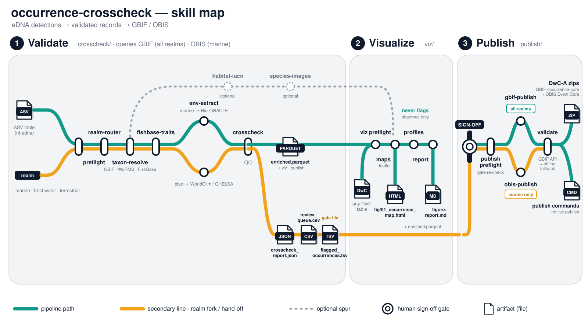

# occurrence-crosscheck

[](#-installation)
[](#-installation)
[](https://github.com/cheahhl814/skill-forge)

Meta-skill for the eDNA occurrence pipeline: (1) cross-check eDNA ASV observations against GBIF/OBIS/WoRMS/FishBase + Bio-ORACLE/WorldClim environmental envelopes (realm-aware: marine/freshwater/terrestrial); (2) publication-ready occurrence figures (maps, profiles, envelopes, trait space); (3) publish validated observations as DwC-A to GBIF/IPT and OBIS (Event Core + DNA-derived data). Router — routes to the three phase sub-skills: crosscheck/, viz/, publish/. Use when asked to 'cross-check eDNA results', 'plot species occurrence', or 'publish eDNA to GBIF/OBIS'.

**Repository**: https://github.com/cheahhl814/occurrence-crosscheck

> [!NOTE]
> Current version: **v2.1.0** (updated 2026-11-11).

## Contents

- [Installation](#-installation)
- [Usage](#-usage)
- [Pipeline overview](#-pipeline-overview)
- [Tools](#-tools)
- [Update check](#-update-check)
- [Repository layout](#-repository-layout)
- [Hard guarantees](#-hard-guarantees)
- [Provenance](#-provenance)

## 🚀 Installation

This is an **agent skill**, not a user-facing library. The recommended install path is to let your AI agent import it.

**Option A — give your agent this prompt (recommended):**

```text
Install the occurrence-crosscheck skill from
https://github.com/cheahhl814/occurrence-crosscheck —
clone it into your agent's skills directory (the path your agent watches
for skills) and run `pixi install` from that directory. Then read the
skill's SKILL.md to understand its phases and the Input/Output contract
for each. Confirm when the environment is ready.
```

**Option B — manual install:**

```bash
git clone https://github.com/cheahhl814/occurrence-crosscheck.git
cd occurrence-crosscheck
pixi install
```

> [!TIP]
> `pixi install` resolves every pinned tool from `pixi.toml` (channels: conda-forge, bioconda) into an isolated `.pixi/` environment — no system-wide installs, no version conflicts with other skills.

## 💡 Usage

The skill is designed to be driven by an AI agent: the agent reads the master `SKILL.md`, detects the current phase from the filesystem state of your run directory, and routes to the right sub-skill.

### Natural-language prompts that trigger the skill

```text
cross-check eDNA results
validate ASV table against GBIF
QC eDNA occurrences
ground-truth eDNA detections
plot species occurrence
```

### Manual phase execution

If you prefer to drive the phases yourself (or want to re-run a single phase):

```bash
# Set your run directory (all phase artifacts land here)
RUN_DIR=/path/to/run-dir

pixi run crosscheck      # Phase 1 — cross-check ASVs against the taxonomic + env backbones
                         #   usage: pixi run crosscheck <asv_table> <realm> <outdir>
pixi run viz             # Phase 2 — publication figures (maps, profiles, envelopes, trait space)
                         #   usage: pixi run viz --input F.parquet --config config/run-config.marine.json --outdir viz_out
pixi run publish         # Phase 3 — gated DwC-A publishing (GBIF/IPT + OBIS), preflight-first
pixi run publish-dry-run # Phase 3 dry run — synthetic fixture end-to-end, no network writes
pixi run test-smoke      # Router structural smoke tests (39 checks)
```

> [!IMPORTANT]
> Each phase has an explicit **Inputs/Outputs contract** at the top of its sub-skill `SKILL.md`. If the upstream artifact is missing (e.g. you run `publish` before `crosscheck` produced `enriched.parquet`), the sub-skill refuses to proceed and tells you which phase to run first. Phases are gated on purpose — don't skip them.

> [!NOTE]
> **This is a router, not a single environment.** The top-level `pixi.toml` carries the *router's* task surface and a Python interpreter for the router's own smoke tests — and nothing else. Each phase sub-skill keeps its **own** pinned workspace (`crosscheck/pixi.toml`, `viz/pixi.toml`, `publish/pixi.toml`) because their toolchains diverge (viz is R-only; crosscheck and publish are Python-first). The `pixi run` tasks above dispatch into those nested workspaces. The envs are deliberately **not** merged.

## 🔬 Pipeline overview



*Metro-map view of the three-phase pipeline — source: [`assets/metro-map.svg`](assets/metro-map.svg) · raster preview: [`assets/metro-map.png`](assets/metro-map.png)*

**What this does, in plain English.** You ran an eDNA experiment: water/soil samples were sequenced, and you got a list of species detected at your site(s). Before a journal or a database accepts that data, someone reasonably asks: *"How do you know these species really occur there, and are your records good enough to publish?"* Checking that by hand — looking up every species, checking known distributions and habitat limits, fixing taxonomy, making figures, formatting submission files — is weeks of tedious work. This skill automates exactly that.

It works in three stages:

1. **Validate** — your species list is cross-checked against the world's public occurrence databases (**GBIF** everywhere, **OBIS** for the ocean), plus trait and habitat databases (FishBase, WoRMS, climate envelopes). The question it answers: *"Is this species actually known from around here, and does the environment fit?"* It never deletes anything — it flags doubtful rows (e.g. "this fish is never recorded within 2,000 km of your site") and hands them to you for a decision.
2. **Visualize** — the result becomes publication-ready figures: an interactive map showing where each species was recorded (your site vs. known occurrences), depth/elevation profiles, and a multi-page report. Think "the figures for the paper, generated for you."
3. **Publish** — the *validated* data is packaged into the exact file formats GBIF and OBIS require (Darwin Core Archives, plus metadata describing how the DNA was collected and sequenced), and it prints the commands to upload them.

The one rule that holds it all together: **nothing gets published without a human signing off.** Validation quarantines every doubtful record into a review file, and the publish stage *refuses to run* until a person has marked each flagged row approved or excluded. It's an assembly line with a mandatory human inspection station — the machine does the 90% grunt work, you make the 10% judgment calls.

One honest caveat: it *checks and packages*; it does not prove a detection is real (that's the lab work), and anything it flags might still be a genuine rare sighting — which is exactly why a human makes the final call.

> [!TIP]
> Read each sub-skill's `SKILL.md` for the full procedure, its ask-user stop points, and its signature library (stderr pattern → cause → fix).

## 🧰 Tools

The router itself ships **no bioinformatics toolchain**. Each phase sub-skill owns its tools, in its own pinned workspace:

| Sub-skill | Workspace | Channels | Tools |
|:----------|:----------|:---------|:------|
| Router (this skill) | `pixi.toml` (top level) | conda-forge | `python` — task dispatch + the router's own smoke tests |
| Phase 1 — Crosscheck | `crosscheck/pixi.toml` | conda-forge, bioconda | `r-base` 4.5, `r-arrow`, `r-duckdb`, `python` 3.11, `pandas`, `pyarrow`, `duckdb`, `rasterio`, `rioxarray`, `netcdf4` |
| Phase 2 — Viz | `viz/pixi.toml` | conda-forge | `r-base`, `r-ggplot2`, `r-sf`, `r-naturalearth`, `r-arrow`, `r-scico`, `r-viridis`, `r-patchwork`, `python` + `jinja2` |
| Phase 3 — Publish | `publish/pixi.toml` | conda-forge | `python` 3.11-3.12, `pandas`, `pyarrow`, `requests` |

> [!TIP]
> `crosscheck/` and `viz/` **track** their `pixi.lock` (their envs are reproduced from the lock); the router's own lock is gitignored and its re-solve is bounded by `exclude-newer` in each manifest.

Tool usage is grounded in the offline `docs-corpus/` snapshots (version-matched `--help`/`man` captures, upstream repo docs, and web docs as fallback) — the agent reads these instead of guessing flags.

## 🔄 Update check

Every skill built with [skill-forge](https://github.com/cheahhl814/skill-forge) ships a self-update check that compares the deployed git SHA against this upstream repo via `git fetch` — no GitHub API call, no extra dependencies.

```bash
pixi run update-check
```

| Verdict | Exit | Meaning |
|:--------|:-----|:--------|
| `UP-TO-DATE` | 0 | Local HEAD matches origin/HEAD |
| `LOCAL-AHEAD` | 0 | Unpushed local commits; no action needed |
| `BEHIND-BY-N` | 1 | Upstream is N commits ahead → re-pull/re-sync from this repo |
| `OFFLINE` | 2 | `git fetch` failed; informational only |
| `NO-ORIGIN` | 2 | No `origin` remote configured; informational only |

## 📁 Repository layout

> **Nested sub-skills (lint note):** `crosscheck/`, `viz/` and `publish/` each carry their own `pixi.toml` but intentionally live inside this one git repo. The `skill-forge` structural linter reports C6 ("pixi.toml present but no `.git`") for each of them — that is an accepted exception for this monorepo, not a defect; do not `git init` the sub-directories. The 13 leaf sub-skills (e.g. `crosscheck/preflight/`, `viz/maps/occurrence-maps/`) carry no READMEs by design — they are not standalone skills.

```text
occurrence-crosscheck/
├── SKILL.md                 # Master orchestrator (router — start here)
├── README.md                # This file
├── pixi.toml                # Router workspace — task dispatch + smoke tests (pixi install)
├── params.json              # Render input — tool inventory + version (tracked)
├── merge-manifest.json      # Merge provenance: pre-merge SHAs per component
├── test_smoke.py            # Router structural smoke tests (pixi run test-smoke)
├── bin/
│   └── skill-update-check.py  # Self-update check (pixi run update-check)
├── crosscheck/              # Phase 1 sub-skill — own pixi.toml + pixi.lock
│   ├── SKILL.md
│   ├── pixi.toml
│   ├── docs-corpus/         # GBIF, OBIS, WoRMS, FishBase, Bio-ORACLE, WorldClim-CHELSA
│   └── preflight/  build/  debug/  battle-test/
├── viz/                     # Phase 2 sub-skill — own pixi.toml + pixi.lock (R renderer)
│   ├── SKILL.md
│   ├── pixi.toml
│   ├── docs-corpus/         # ggplot2, sf, rnaturalearth, arrow-r, scico, viridis
│   └── preflight/  maps/  profiles-env/  report/
└── publish/                 # Phase 3 sub-skill — own pixi.toml
    ├── SKILL.md
    ├── pixi.toml
    ├── docs-corpus/         # DwC-A profile, EML 2, GBIF validator, OBIS DNA data
    └── preflight/  gbif-publish/  obis-publish/  validate/
```

## 🔒 Hard guarantees

- **Filesystem evidence chain** — every phase emits the artifact the next phase consumes; the boundary between phases is the filesystem, not agent memory.
- **Docs-grounded tool usage** — tool flags come from `docs-corpus/`, never from the agent's memory.
- **Explicit stop points** — ambiguous decisions are surfaced to you as *Evidence + Recommend + Options*, not auto-picked.
- **Reproducible environments** — every tool is pinned in a `pixi.toml` and resolved via pixi. Each phase sub-skill keeps its own pinned workspace; the router's own manifest carries no toolchain.

## 🚀 Nextflow runner

This skill does not currently ship a Nextflow runner. For cohort/HPC execution, wrap the `pixi run` tasks in a workflow scheduler of your choice.

## Provenance

Built with the [skill-forge](https://github.com/cheahhl814/skill-forge) meta-skill (v1.x), following the AiX-BIO skill convention (preflight → build → debug → battle-test evidence chain). Pattern adopted from:

- **BettaMt-agents** — https://github.com/cheahhl814/BettaMt-agents
- **bacterial-genome-analysis** — https://github.com/cheahhl814/bacterial-genome-analysis
- **amr-gene-screening** — https://github.com/cheahhl814/amr-gene-screening

## License

Released under the MIT License — see the license file in this repository for details.